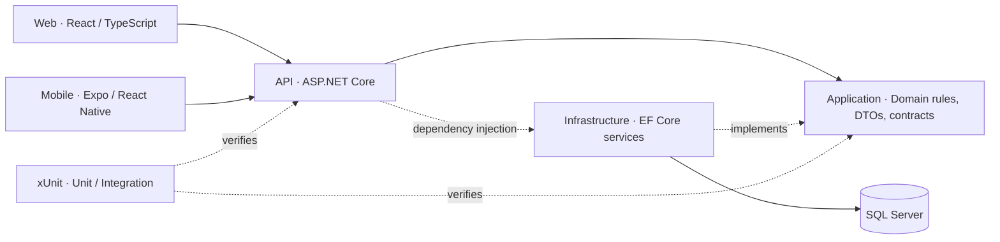
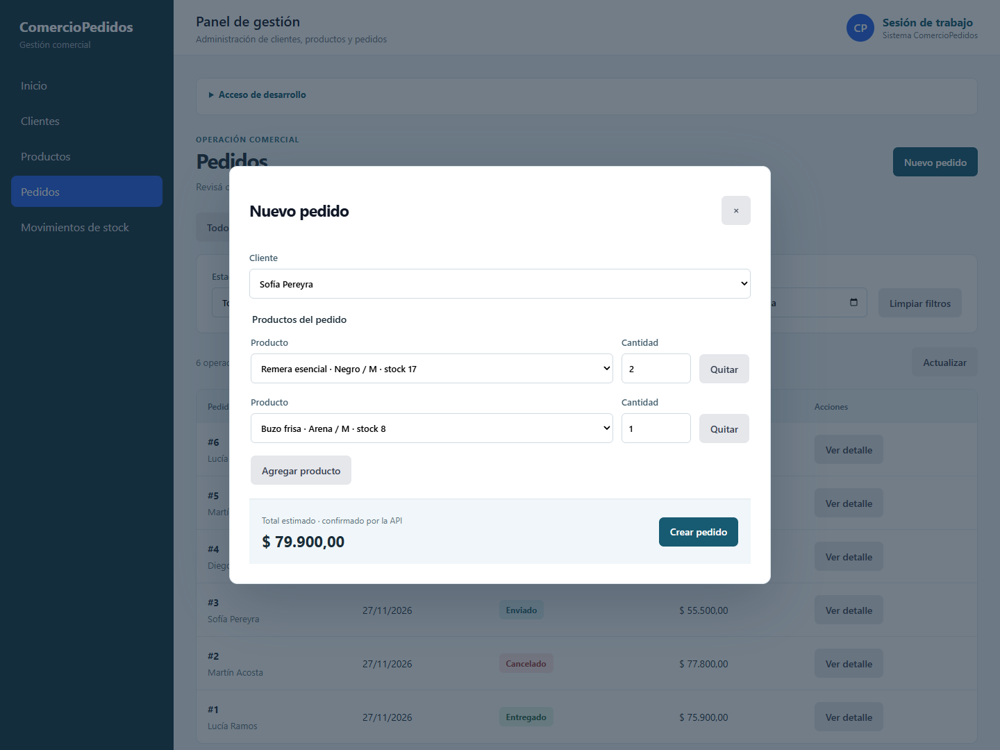
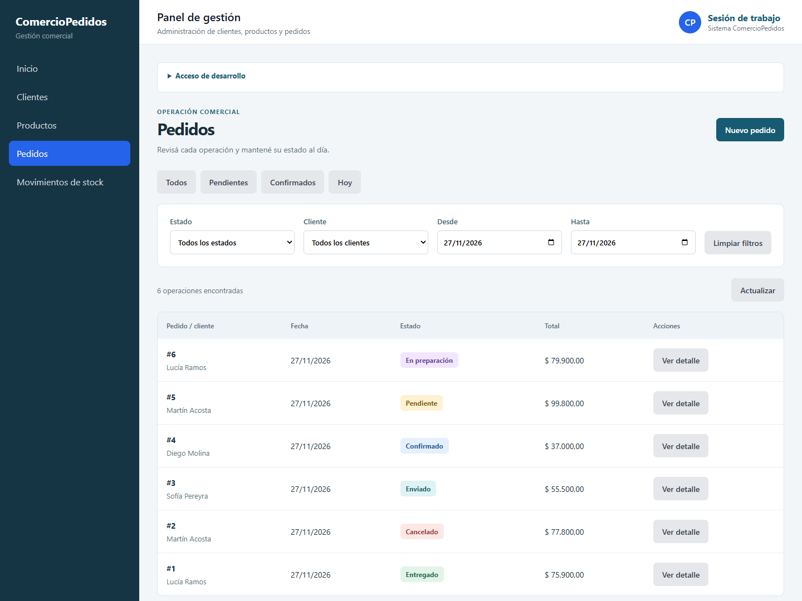
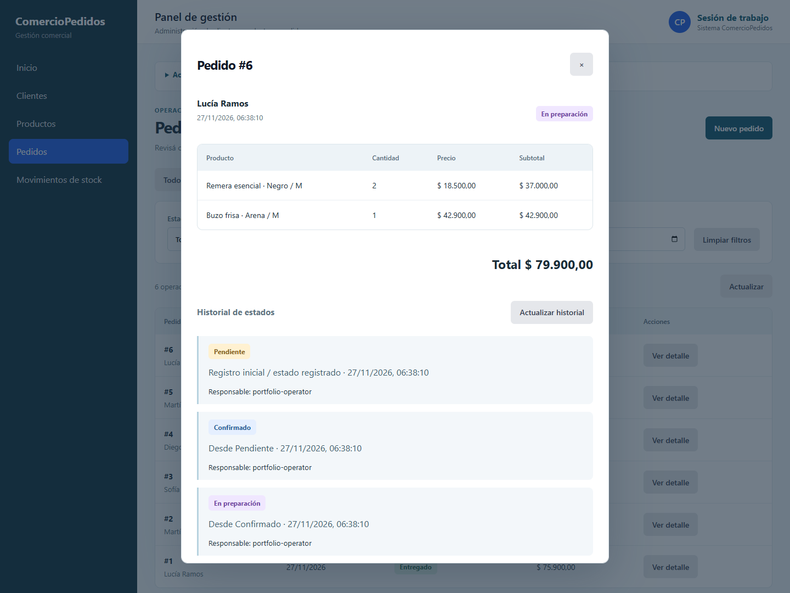
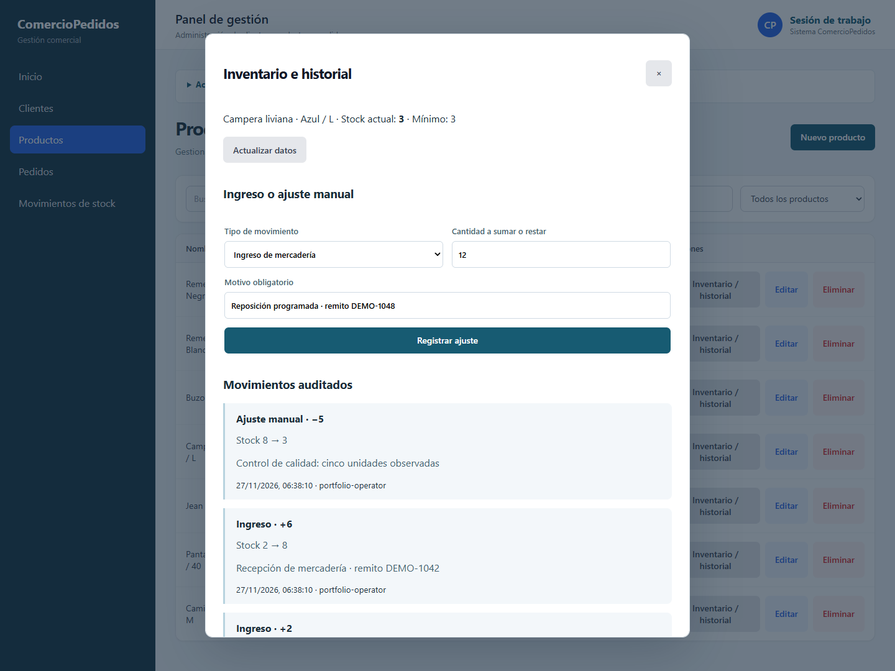
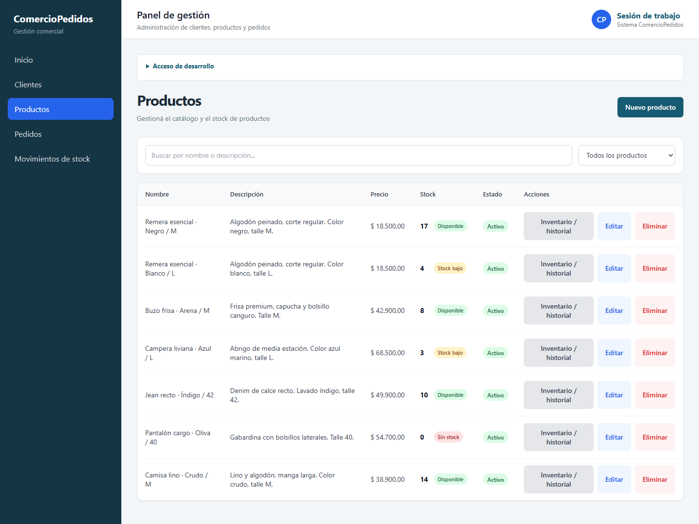

# ComercioPedidos

**Commercial operations, transactional inventory and auditable order tracking.**

ComercioPedidos is a full-stack commercial and inventory management system built with **.NET 10, SQL Server, React + TypeScript and Expo React Native + TypeScript**. It brings customer records, product availability, order fulfillment and stock movements into one API shared by Web and Mobile.

The engineering focus is reliable business operations: reserve stock atomically, prevent conflicting updates, enforce access at the resource level and explain inventory and order-state changes with an audit trail.

[Explore the public demo](https://nicolas-giron-comerciopedidos-demo.nicogiron09.chatgpt.site/) · [Security implementation](SECURITY-ETAPA1.md) · [Client UX](UX-ETAPA2.md) · [Lifecycle and inventory design](ETAPA3.md)

The public demo is a separate interactive showcase with fictional data. The screenshots below come from the local repository application backed by SQL Server; the hosted demo may not include every feature in this branch.

## Key Engineering Highlights

### Security & Reliability — Stage 1

- **Configurable JWT/OIDC validation:** issuer, audience, signature and expiration checks, with no embedded production signing keys or anonymous development bypass.
- **Role-based authorization:** administrators and operators manage commercial operations; customers access only their own orders. Ownership is checked on the server.
- **Strict request DTOs:** nested validation, numeric bounds and rejection of unmapped JSON properties limit invalid input and over-posting.
- **RFC 7807 `ProblemDetails`:** consistent validation feedback, meaningful HTTP status codes and sanitized unexpected errors with a trace ID.
- **Automated verification:** xUnit unit tests, `WebApplicationFactory` integration tests, real JWT validation tests and SQL Server migration/concurrency checks.

### Transactional Inventory & Order Lifecycle — Stage 3

```text
Pending → Confirmed → In preparation → Shipped → Delivered
   └────────────── Cancelled from any pre-delivery state
```

- **Atomic reservation and release:** creating an order deducts available stock; cancelling returns it exactly once. Later fulfillment steps do not deduct stock again.
- **Optimistic concurrency:** application-managed GUID `Version` tokens on products and orders supplement the existing `Stock`/`Estado` tokens. They detect intervening updates even when stock returns to its previous value. This implementation uses version tokens rather than SQL Server `rowversion` or `[Timestamp]`.
- **Inventory audit:** `MovimientoStock` records direction, movement category, quantity, previous/new stock, optional order reference, reason, authenticated actor and UTC timestamp. Initial stock and legacy update routes also leave audit records.
- **Order audit:** `HistorialEstadoPedido` records previous/new states, UTC time and the responsible user. Audit rows are append-only through the application context.
- **Replenishment alerts:** active products with `Stock <= StockMinimo` appear in low-stock alerts, including out-of-stock items. The threshold is configurable per product.
- **Conflict feedback:** insufficient stock or concurrent writes return **409**; invalid state transitions return **422**. Availability is revalidated by the server at submission time.

For older clients, the existing delivery endpoint still accepts `Confirmed → Delivered`. The new UI follows preparation and shipping. Delivered and Cancelled are terminal states.

### Web & Mobile UX — Stage 2, Extended in Stage 3

- Centralized `ProblemDetails` parsing with field validation messages and support for legacy `mensaje` responses.
- Explicit session-required/expired handling for **401**, and a non-blocking permissions notice for **403**.
- Loading, empty and retry states; progress indicators and synchronous guards against double submission.
- Responsive order tables/cards with state, customer and date filters, semantic badges and destructive-action confirmation.
- Inventory history and adjustment forms with mandatory reasons and the version read by the client.
- Expo cart with a fixed summary, touch-friendly quantity controls, stock limits and order tracking with pull-to-refresh.

## Architecture & Tech Stack



| Area | Implementation |
| --- | --- |
| Domain concepts | Entities, enums and pure order rules inside `ComercioPedidos.Application`; there is no separate Domain project |
| Application | Typed DTOs, validation attributes and service interfaces; no EF Core or ASP.NET dependency |
| API | .NET 10 / ASP.NET Core, JWT Bearer, authorization policies, controllers, global errors and development Swagger |
| Infrastructure | EF Core 10 / SQL Server, migrations, transactional services and concurrency handling |
| Web | React 19, TypeScript, Vite, React Router and Axios |
| Mobile | Expo SDK 57, React Native 0.86, TypeScript and Expo Router |
| Tests | xUnit, `WebApplicationFactory`, SQLite and SQL Server LocalDB; Node client-core tests and Playwright |

```text
ComercioPedidos/backend/
├── ComercioPedidos.Application/      # Entities, Rules, DTO, Enum, Services
├── ComercioPedidos.API/              # Controllers, Security, Validation, Exceptions
├── ComercioPedidos.Infrastructure/   # Data, Migrations, Services
├── tests/                           # UnitTests and IntegrationTests
└── ComercioPedidos.slnx
ComercioPedidos/frontend/             # Web client
comercio-pedidos-mobile/              # Expo client
tests/                               # Client-core and browser checks
docs/screenshots/                     # Local application screenshots
```

## Screenshots Gallery

Captured against the real API using an isolated SQL Server LocalDB database with fictional apparel, customers and orders. All images are **1440 × 1080, device scale factor 1**, with the existing Spanish UI and a UTC browser timezone. Sizes and colors are product labels in this dataset, not a separate variant model.

### Catalog-backed order entry

Select catalog items using current stock, choose quantities and review the estimated total. Final prices and availability are validated by the API.



### Order management and filters

Date, customer and state filters alongside badges for Pending, Confirmed, In preparation, Shipped, Cancelled and Delivered orders.



### Audited order timeline

Order lines and totals alongside recorded transitions, timestamps and the responsible development identity.



### Inventory adjustments and movements

A product at its replenishment threshold, an adjustment form with a mandatory reason, and stock movements with before/after quantities and actor attribution. The populated form is a draft; it was not submitted for this capture.



### Catalog availability

Apparel products with size/color labels, current stock, availability badges, low-stock alerts and out-of-stock status.



## Getting Started

### Prerequisites

- .NET SDK **10.x** and Node.js **22.x** with npm.
- SQL Server, or **SQL Server Express LocalDB on Windows**, with permission to create/update a development database.
- Git and the pinned EF CLI restored from `.config/dotnet-tools.json`.
- For native Mobile: a device/development build or emulator compatible with Expo SDK 57. Web export does not require native build tools; an iOS simulator requires macOS.

Commands use PowerShell and start at the repository root unless a `Set-Location` command says otherwise. Use a branch containing Stages 1–3; during review, that implementation is on [the Stage 3 branch](https://github.com/HiroNk11/Proyecto-BackEnd-BaseDeDatos-FrontEnd/tree/codex/etapa3-trazabilidad-2026-11-27).

### 1. Restore Dependencies and Configure SQL Server

```powershell
git clone https://github.com/HiroNk11/Proyecto-BackEnd-BaseDeDatos-FrontEnd.git
Set-Location Proyecto-BackEnd-BaseDeDatos-FrontEnd
# Before the Stage 3 merge, check out its implementation:
git switch codex/etapa3-trazabilidad-2026-11-27

$api = 'ComercioPedidos/backend/ComercioPedidos.API'
dotnet restore ComercioPedidos/backend/ComercioPedidos.slnx --force
dotnet tool restore

# Windows LocalDB example; replace with your development SQL Server connection.
$env:ConnectionStrings__ComercioPedidos = 'Server=(localdb)\MSSQLLocalDB;Database=ComercioPedidosLocal;Integrated Security=true;TrustServerCertificate=true'
dotnet user-secrets set 'ConnectionStrings:ComercioPedidos' "$env:ConnectionStrings__ComercioPedidos" --project $api

dotnet ef database update `
  --project ComercioPedidos/backend/ComercioPedidos.Infrastructure `
  --startup-project $api
```

The API reads User Secrets in Development. The design-time EF factory reads `ConnectionStrings__ComercioPedidos` from the environment, so keep it set while running migrations. These commands create the schema without seeding business data. Create customers/products and orders through the UI or authenticated API.

### 2. Generate a Development Token and Start the API

```powershell
dotnet user-secrets set 'Authentication:Audience' 'comerciopedidos-local' --project $api
dotnet user-secrets set 'Authentication:Issuer' 'dotnet-user-jwts' --project $api

dotnet user-jwts create --project $api `
  --name local-operator --role Admin `
  --audience comerciopedidos-local --issuer dotnet-user-jwts --valid-for 2h

$env:ASPNETCORE_ENVIRONMENT = 'Development'
dotnet run --project $api --no-launch-profile --urls http://localhost:5272
```

Copy the generated token into **Acceso de desarrollo** in the client. The tool creates signing material outside the repository and updates Development scheme settings. Keep token output, signing material and local configuration out of commits. `user-jwts` already generates `sub` from `--name`; do not add a duplicate `sub` claim. The manual token control is development-only and stores the token in memory.

API: `http://localhost:5272/api` · Development API documentation: `http://localhost:5272/swagger`

For a customer token, use `--role Cliente --claim cliente_id=<existing-customer-id>` instead of `--role Admin`. The identity provider must bind that identity to a single valid customer record. The administrative customer directory and inventory operations require staff permissions.

### 3. Start Web

In a second terminal, from the repository root:

```powershell
Set-Location ComercioPedidos/frontend
npm ci --ignore-scripts
$env:VITE_API_URL = 'http://localhost:5272/api'
npm run dev -- --host localhost --port 5173 --strictPort
```

Open `http://localhost:5173`. The configured development CORS origin is `http://localhost:5173`; explicitly add other browser origins to `Cors:AllowedOrigins`. `VITE_API_URL` is a public API address, never a place for a token or signing key.

### 4. Start Mobile

In another terminal, from the repository root:

```powershell
Set-Location comercio-pedidos-mobile
npm ci --ignore-scripts
$env:EXPO_PUBLIC_API_URL = 'http://localhost:5272/api'
npm run web
# Or start the device/emulator workflow:
# npm start
```

For a physical device, replace `localhost` with the development machine's reachable LAN address and bind the API to that interface. An Android emulator typically reaches the host through `10.0.2.2`. Configure CORS for any additional browser origin; native network access and platform HTTP/HTTPS restrictions must also be satisfied. Install SDK-compatible native dependencies with `npx expo install`.

### Production Identity Configuration

Use your deployment secret/configuration provider for:

```text
ConnectionStrings__ComercioPedidos
Authentication__Authority   # HTTPS discovery authority
Authentication__Audience
Authentication__Issuer      # Explicit issuer when required
Cors__AllowedOrigins__0     # Exact allowed Web origin
```

| Concept | Exact token role value |
| --- | --- |
| Administrator | `Admin` |
| Operator | `Operador` |
| Customer | `Cliente` |

Role claims use `role`; customer ownership uses `cliente_id`. Integrate the chosen OIDC SDK through `setAccessTokenProvider` in Web `src/services/http.ts` or Mobile `src/services/authorizedFetch.ts`. This repository validates access tokens; it does not implement a production identity provider, hosted login or refresh-token flow.

## Testing & Builds

From the repository root:

```powershell
dotnet build ComercioPedidos/backend/ComercioPedidos.slnx --no-incremental -warnaserror
dotnet test ComercioPedidos/backend/ComercioPedidos.slnx --no-build

# Windows: integration tests with isolated SQL Server LocalDB databases.
$env:COMERCIO_TEST_SQL_SERVER = '(localdb)\MSSQLLocalDB'
dotnet test ComercioPedidos/backend/ComercioPedidos.slnx --no-build
Remove-Item Env:COMERCIO_TEST_SQL_SERVER
```

There are **75 .NET test cases**: 28 unit and 47 integration cases. Without the SQL variable, general integration tests use SQLite and the SQL-specific migration case is skipped. With LocalDB, all 75 run, including a schema upgrade with existing data, repeat migration application and concurrency checks. Test factories create uniquely named temporary databases and remove them afterward.

In **each client directory**:

```powershell
npm run typecheck
npm run lint
npm run build
```

In `ComercioPedidos/frontend`, `npm test` runs **12 client-core tests** across both clients. Expo's build exports Android, iOS and Web bundles; it does not create signed APK/IPA artifacts or replace device testing.

For Playwright regression checks, start Web on **4175** and Expo Web on **8087**, then run `npm run test:ux` from the Web directory. These tests use controlled HTTP fixtures and Chrome; they do not seed a real deployment. See [client test instructions](UX-ETAPA2.md) for server commands. The screenshots above were captured separately against the real local API.

GitHub Actions validates backend builds/tests with SQLite and Windows LocalDB, plus type checks, strict lint and builds for both clients.

## API Guide

| Operation | Endpoint | Access |
| --- | --- | --- |
| List / create / inspect orders | `GET/POST /api/pedidos`, `GET /api/pedidos/{id}` | Staff; customers only within their ownership |
| Confirm / prepare / ship / deliver | `PUT /api/pedidos/{id}/confirmar`, `/preparar`, `/enviar`, `/entregar` | `Admin`, `Operador` |
| Cancel and release stock | `PUT /api/pedidos/{id}/cancelar` | Staff or the owning customer |
| Audited inventory adjustment | `POST /api/productos/{id}/ajustes-stock` | `Admin`, `Operador` |
| Paginated stock history | `GET /api/productos/{id}/movimientos-stock` | `Admin`, `Operador` |
| Replenishment alerts | `GET /api/productos/stock-bajo` | `Admin`, `Operador` |

API state values remain `Pendiente`, `Confirmado`, `EnPreparacion`, `Enviado`, `Entregado` and `Cancelado`. Inventory adjustments accept `tipoMovimiento` (`Ingreso` or `AjusteManual`), a signed nonzero `cantidad`, a mandatory `motivo` and an optional product `version`. History preserves legacy names while adding `tipoMovimiento`, `usuarioId`, `fechaUtc` and `stockNuevo`. See [Stage 3 contracts and migration notes](ETAPA3.md) for details.
